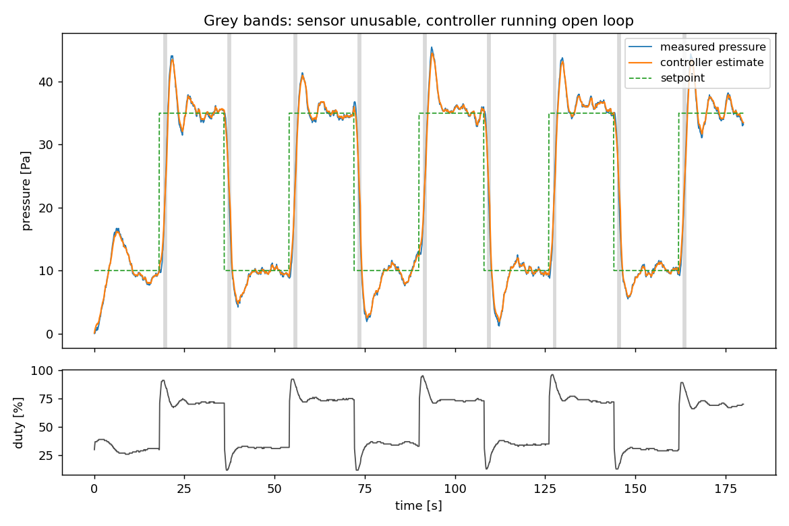
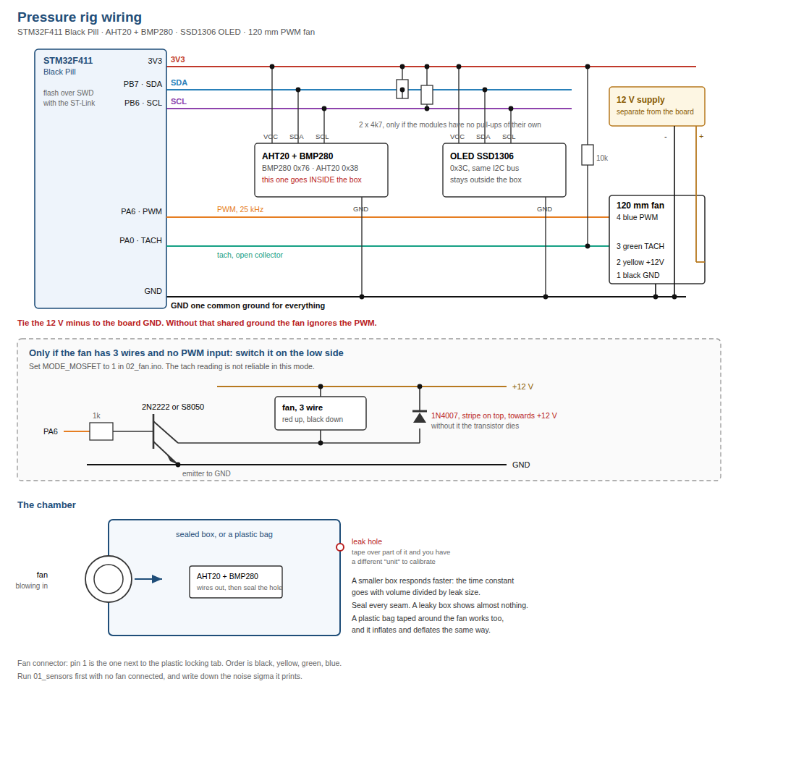

# Closed-loop pressure control on STM32, with a sensor that goes blind

A desk rig I built to answer a question I could not answer from reading: what
does it actually cost a control loop when its sensor stops being usable over
part of the range, and how long can you afford to run open before the error
shows up in the output?

A fan drives a sealed box. A differential pressure sensor measures the box. An
STM32F411 running FreeRTOS closes the loop at 20 Hz. The blind band is imposed
in software, so the controller is forbidden from using the sensor inside the
band while the sensor keeps logging the truth. That is the whole trick in the
method: it turns an argument into a measurement, because you always have the
ground truth the controller is not allowed to see.



Grey bands are the crossings where the controller is running on its own
estimate. The orange trace is what the controller believes; the blue trace is
what is really happening.

## What is in here

```
Core/Src/freertos.c          control loop, identifier, logger, supervisor
Core/Src/main.c, tim.c, ...  CubeMX generated peripheral setup
Lib/ssd1306/                 display driver
tools/rig.py                 log format, plant model, episode detection
tools/decode_log.py          dump to CSV and a quick look plot
tools/analyse_plant.py       identify the static plant, compare across runs
tools/analyse_blind.py       cost of each blind crossing
tools/analyse_adaptation.py  does the online identifier converge to the truth
data/*.bin                   seven raw logs straight off the device
```

Everything interesting is in `Core/Src/freertos.c`. The rest of `Core`,
`Drivers` and `Middlewares` is STM32CubeMX and FreeRTOS, checked in so the
project builds without having to regenerate it.

### Running the analysis

```
python3 tools/analyse_plant.py      data/*.bin
python3 tools/analyse_blind.py      data/hybrid_run.bin docs/figures/blind_band.png
python3 tools/analyse_adaptation.py data/pair*_adaptive.bin
```

Needs numpy and matplotlib, nothing else, and no hardware: the logs in `data/`
are real dumps off the device, so every number below can be reproduced from
this repository alone.

### Building the firmware

CMake with the arm-none-eabi toolchain, presets included.

```
cmake --preset Debug
cmake --build --preset Debug
```

Needs `arm-none-eabi-gcc` and `ninja` on PATH. If CMake complains that it
cannot configure, delete `build/` and configure again: a CMake cache remembers
the absolute path it was created at, so it stops working the moment the
project is moved or renamed.

The build produces `pressure_control_rig.elf` plus a `.bin` and a `.hex` in
`build/Debug/`. The `.elf` is an ARM binary and will not run on your laptop;
it is flashed to the board, for example with

```
st-flash write build/Debug/pressure_control_rig.bin 0x8000000
```

## The controller

Three pieces, and the split is the point.

**Feedforward** from a measured characterisation of the plant. The fan is not
linear, so the model is a scale factor and an offset on top of a measured
curve rather than a straight line: `pressure = k * table(duty) + b`.

**Feedback trim**, enabled only where the measurement can be trusted. On the
way into the blind band the integrator is frozen rather than left running, and
coming out the other side the transfer back to closed loop is bumpless, with
hysteresis on the band edges so a noisy sample sitting on the boundary cannot
make the controller flap between modes. Rate limiting is applied to the
feedback branch only, so a late correction cannot arrive as a step.

**Online identification** of `k` and `b` while running, with gating. This is
the part that taught me the most, and it is covered below.

Outside the loop sits a supervisor with a defined safe state. The loop can be
wrong; the supervisor decides when being wrong matters.

## What the measurements say

### The plant repeats, the offset does not

Across seven runs on different days, the gain `k` has a spread of about 0.08 on
a mean of 0.93, while the offset `b` moves by several pascals. A stored
calibration of the gain is worth having. A stored calibration of the offset is
not, and that is the argument for identifying it online rather than trusting a
number from the factory.

### What a blind crossing costs

On the run plotted above, nine crossings, each about 0.7 s. The estimate drifts
2.2 Pa on average and 3.1 Pa at worst by the time the sensor comes back, and
the step when the loop reconnects averages 6 Pa.

Those numbers convert the design question into arithmetic: the error you are
willing to accept, divided by the drift rate, bounds how long you can afford to
be blind.

**The honest caveat**, which the script prints for you: a drift rate is only
identifiable when the blind durations within a run actually differ. On this
particular run they are all between 0.57 and 0.72 s, the correlation is -0.35,
and the slope is fitting noise. The script refuses to quote a rate when the
correlation does not support one. I had to learn to do that, because the first
version happily printed a confident number.

### Does the identifier converge

Each adaptive run starts from a deliberately wrong model and corrects it while
running. Scored against the plant fitted from the same run, over three
independent runs, the identifier removes **67%, 70% and 82%** of the initial
model error.

Scoring against the same run matters. An earlier version of this analysis
compared a run against a plant measured on a different day, and produced a
clean, confident, wrong conclusion, because the rig itself moves between
sessions. Same-duty raw data showed the box had shifted by 5 Pa at low duty
between two sessions, which was larger than the effect being measured.

## Three things this rig taught me

**Build the measurement before the feature.** All seven faults I found came out
of a logged trace, not out of thinking at the desk. The worst of them was a
constant 21 Pa offset I spent hours chasing in the controller: a constant error
at every actuator setting cannot come from a gain, so it had to be in the
reference, and it was. The run was zeroing itself while the box was still
venting from the previous run. Holding the actuator off and waiting for the
pressure to be quiet for three seconds before zeroing took the steady-state
tracking error from 3.1 Pa to 0.98 Pa.

**An algorithm does not warn you when the data cannot support the answer.** The
identifier converged confidently and got worse. Logging every sample it
accepted showed that in three minutes it had accepted ten, all inside a four
percentage point window of actuator output. From a single operating point,
infinitely many gain and offset pairs fit equally well, and it had picked one.
This is the persistency of excitation condition, and the fix was to check how
much the input had actually moved and to update only one parameter when it had
not moved enough.

**Reproduce it before you believe it.** A change once looked better than it
deserved to. Running the identical configuration a second time, with nothing
altered, produced results that differed by a factor of three and a half on that
metric. No single before-and-after comparison on that metric could support any
claim. I switched metric and started running three independent pairs instead of
one. It cost seven minutes to find out.

## Logging, since that is half the project

A 36 KB ring buffer in RAM holds a ten-field record at a fixed 10 Hz, written
from the control task without disturbing its timing. It is pulled off over the
debugger with `dump binary memory` and decoded in Python. The record layout is
documented at the top of `tools/rig.py`.

Small, fixed, static. There is no dynamic allocation anywhere after start-up:
on a part with 128 KB of RAM, a failed allocation at the wrong moment is a dead
product rather than an exception.

## Hardware



STM32F411 "Black Pill", FreeRTOS. 25 kHz PWM on TIM1_CH1 driving the fan
through a transistor, tachometer capture on TIM2, BMP280 and AHT20 on a shared
I2C bus behind a mutex, SSD1306 display. The mutex is taken for the duration of
a transfer and never held across a delay.

The peripheral configuration lives in `pressure_control_rig.ioc` and can be reopened in
STM32CubeMX. Editor settings are deliberately not committed: the CMake
extension in VS Code needs `cube-cmake` on its PATH, which a GUI application
on macOS does not inherit from the shell, so a committed `cmake.cmakePath`
breaks the build for everyone except the machine it was written on. Build from
the command line, or point your own local settings at an absolute path.

---

Built and measured by me, on my own desk, in my own time. No employer's data,
hardware or product is involved, and none is described here.
